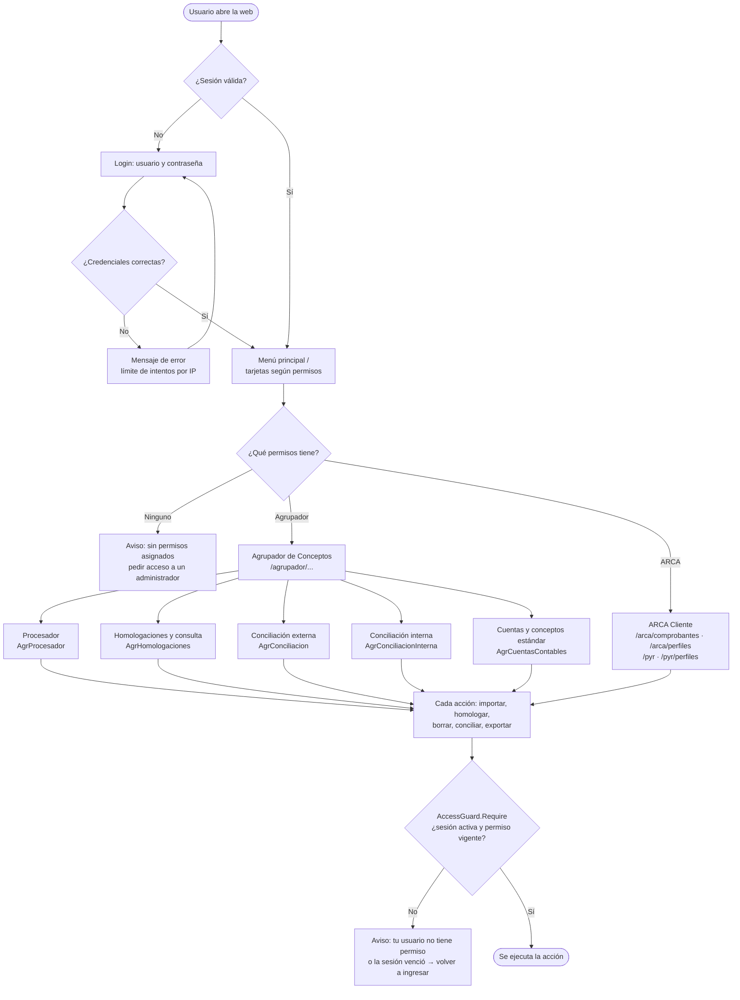
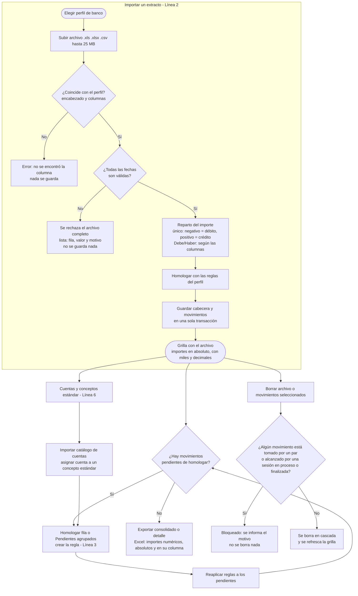
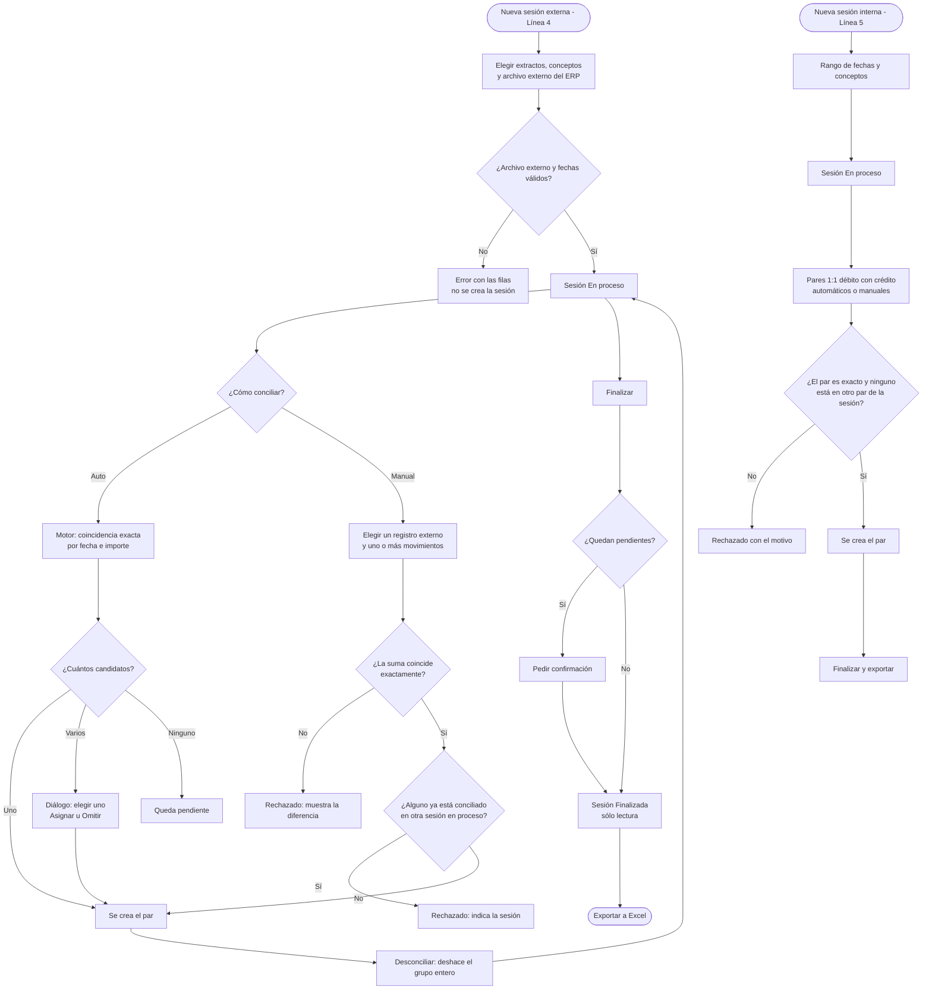

# Web: menú principal y Agrupador de Conceptos — guía de diseño (TAREA 00097)

Estado: **guía aprobada** (14/10/2026). **Flujograma y maquetas hechos, pendientes de aprobación.** Sin código.

## Qué es

`Conciliador.Web` hoy tiene un solo módulo: **ArcaCliente** (comprobantes, perfiles, percepciones y
retenciones). Falta el resto de ConciliadorContable. Esta tarea agrega a la web:

1. un **menú principal** de la suite, por módulos y con los mismos permisos por botón que el escritorio;
2. el **Agrupador de Conceptos** completo —las once pantallas y cinco diálogos del escritorio—,
   para que el sector contable pueda trabajar los extractos bancarios desde el navegador.

La web **no reemplaza** al escritorio: conviven sobre la misma base SQL (`bancos`), con el mismo
bloqueo de aplicación para las mutaciones, y las mismas reglas.

## Pedido

Pedido textual: «En la web (Conciliador.Web) solo se hizo ArcaCliente. Completar el trabajo: crear
el menú principal de ConciliadorContable en la web y pasar el Agrupador de Conceptos con todas sus
ventanas y funcionalidades. Ya hay VPN para verificar el SQL.»

Numeración confirmada por el usuario (comentario `Linea: N` en el código):

| Línea | Ítem |
|---|---|
| 1 | **Menú principal web**: inicio por módulos (ARCA Cliente, Agrupador), permisos por botón. Incluye la biblioteca común del Agrupador (`AgrupadorConceptos.Core`) y la infraestructura web compartida. |
| 2 | **Agrupador · Procesador**: perfiles de banco, importar extracto, grilla, homologación individual y masiva, exportar consolidado y detalle, borrar archivo y movimientos. |
| 3 | **Agrupador · Gestión de homologaciones**: alta, edición, baja con cálculo de impacto, y consulta de movimientos por conceptos. |
| 4 | **Agrupador · Conciliación externa**: sesiones con varios archivos, selector de extractos, pares 1:N, selección de candidatos, finalizar, exportar. |
| 5 | **Agrupador · Conciliación interna**: sesiones por rango y conceptos, pendientes de débito y crédito, conciliados, finalizar, exportar. |
| 6 | **Agrupador · Cuentas contables y conceptos estándar**: importar el catálogo desde Excel/CSV, asignar cuenta a un concepto estándar. |
| 7 | **Importes en toda la web del Agrupador**: separador de miles y decimales, en valor absoluto y en la columna que corresponde (Débitos o Créditos). Agregado por el usuario al aprobar la guía; atraviesa las líneas 2 a 6. |

Fuera de alcance: administración de usuarios en la web (no aparece en el menú), conexión online a ARCA
y todo lo que ya existía en la web.

## Arquitectura (decisiones que condicionan todo lo demás)

**A1 — Biblioteca común `AgrupadorConceptos.Core`.** `AgrupadorConceptos` es WinForms
(`net8.0-windows`) y la web no puede referenciarla. Se repite la receta de ArcaCliente (TAREA 00064):
un proyecto `AgrupadorConceptos.Core` (`net8.0`, sin WinForms ni Telerik) recibe `Models/`, `Services/` y
`Data/`; el proyecto WinForms los excluye con `Compile Remove` y referencia al Core. Las pantallas se quedan donde están.
Hay dos filtraciones de interfaz para limpiar: `Services/FechasPresentacion.cs` usa Telerik (se queda en
WinForms) y `Data/MovimientoStorage.cs` tiene un `using` de Telerik que sobra. El comportamiento del
escritorio no cambia, y lo prueba `Homologador.Tests` (15 pruebas) antes y después del traslado.

**A2 — Estado por circuito.** Igual que `Workspace` y `PyRWorkspace`: una clase `AgrupadorWorkspace` por
circuito Blazor con el archivo abierto, el perfil, la sesión de conciliación activa y la selección. Nada se
comparte entre usuarios.

**A3 — Conexión a la base.** El Core usa `SqlDb.ConnectionString` (estático, una sola base). La web lo fija
al arrancar desde `ConnectionStrings:Arca`, que ya apunta a la misma base. Las pantallas de ARCA siguen
usando sus almacenes con conexión explícita. El Agrupador no tiene modo demostración: requiere SQL.

**A4 — Permisos.** Se agregan políticas web `AgrProcesador`, `AgrHomologaciones`, `AgrConciliacion`,
`AgrConciliacionInterna` y `AgrCuentasContables`, con la misma regla que las de ARCA (Admin o el permiso).
**Cada acción** vuelve a comprobar el permiso con `AccessGuard.Require`, también en circuitos ya abiertos.

**A5 — Grillas sin librerías de pago.** El escritorio usa Telerik; la web usa tablas Blazor con
`<Virtualize>` (un archivo bancario tiene miles de filas; la consulta de conceptos llega a decenas de miles).
Edición en línea sólo de *Concepto final* y *Cuenta final*, como hoy.

**A6 — Archivos.** La importación recibe el archivo por `InputFile` (flujo, no ruta): se agrega una
sobrecarga por `Stream` a `ImportacionService`, `ArchivoExternoReader` y la importación de cuentas, sin
cambiar la lógica. Límite de 25 MB y extensiones `.xls`, `.xlsx`, `.csv`. Las exportaciones a Excel se
descargan con `download.js`; los exportadores ganan una salida a `Stream`/`byte[]`.

**A7 — Operaciones largas.** Importar 7.800 movimientos tarda segundos: el avance (`ProgresoImportacion`) se
muestra con una barra por pasos, una sola importación por usuario a la vez, y el botón se deshabilita
mientras corre.

**A8 — Inicio y URLs.** `/` pasa a ser el **menú principal**. Los accesos de ARCA se mueven a
`/arca/comprobantes` y `/arca/perfiles`; las URLs viejas (`/` ya no, `/perfiles`) redirigen. `/pyr` y
`/pyr/perfiles` no cambian. El Agrupador vive bajo `/agrupador/...`.

## Modelo de datos

**No hay tablas nuevas.** Se usan las existentes del esquema `bancos`, ya con fechas tipadas (TAREA 00083):

| Tabla | Para qué |
|---|---|
| `PerfilesBanco` | Perfil por banco: columnas, fila de encabezado, importe único o Debe/Haber, cuenta de referencia. |
| `ConceptosEstandar`, `HomologacionConceptos` | Catálogo de conceptos y reglas que traducen el texto del banco. |
| `CuentasContables` | Catálogo importado del sistema legacy; una cuenta puede asignarse a un concepto estándar. |
| `ArchivosImportados`, `MovimientosArchivo` | Cabecera y movimientos de cada extracto (`Fecha date`, `FechaTextoOriginal`). |
| `ConciliacionSesiones`, `ConciliacionItemsExternos`, `ConciliacionPares` | Conciliación externa. |
| `ConciliacionInternaSesiones`, `ConciliacionInternaPares` | Conciliación interna. |

Estado de trabajo en memoria por circuito (`AgrupadorWorkspace`): archivo y perfil en pantalla, filas
seleccionadas, sesión activa, resultado de la última importación.

## Reglas (las del escritorio, sin cambios)

- **Fechas:** `dd/MM/yyyy` en pantalla y Excel; un archivo con alguna fecha vacía o inválida se rechaza
  completo, listando archivo, fila, valor y motivo (nada queda guardado).
- **Importes al importar:** importe único negativo → débito, positivo → crédito (ambos se guardan en valor
  absoluto); Debe/Haber según las columnas del perfil.
- **Importes al mostrar (Línea 7):**
  - Todo importe lleva **separador de miles y dos decimales**: `1.234.567,89`. Formato `es-AR` fijo, sin depender
    de la cultura del servidor ni del navegador.
  - Se muestra en **valor absoluto**, sin signo, y **en la columna que le corresponde**: un débito en
    *Débitos* y un crédito en *Créditos*. En la otra columna se muestra `0,00` en gris. Un dato ausente
    (nulo) queda en blanco.
  - Vale para grillas, totales, resúmenes, diálogos, vista previa y mensajes. En Excel el importe es un
    **número real** con formato `#,##0.00`, no un texto, con la misma regla de absoluto y columna.
  - Es solo **presentación**: lo guardado en la base no cambia, y un dato histórico que tuviera signo se ve
    igual de bien. Un único formateador en `AgrupadorConceptos.Core` lo aplica en todas las pantallas.
  - Excepción: la **diferencia** (créditos − débitos) es un resultado, no un importe de movimiento; conserva su
    signo, rotulada «Diferencia (C − D)», como ya se muestra en la consulta de conceptos (TAREA 00075).
- **Homologación:** un movimiento toma el concepto estándar de la primera regla que coincide; `Pendiente de
  homologar` si ninguna; la cuenta final sale sólo del concepto estándar.
- **Bajas protegidas:** un archivo o movimiento no se borra si lo toma un par de conciliación (externa o
  interna) o lo alcanza una sesión en proceso o finalizada; se informa el motivo y no se borra nada
  (TAREAS 00076 y 00096, validación por consulta sin lista de IDs).
- **Conciliación externa:** pares 1:N exactos (la suma debe coincidir); desconciliar un grupo lo deshace entero;
  una sesión finalizada no admite cambios.
- **Concurrencia:** las mutaciones toman el bloqueo `bancos.Conciliacion.Mutacion` y revalidan; web y
  escritorio pueden convivir.
- **Esquema:** si la base no está migrada, el arranque se detiene con el mensaje que pide migrar.

## Pantallas

| Ruta | Pantalla | Línea | Equivale a (escritorio) |
|---|---|---|---|
| `/` | Menú principal: tarjetas por módulo según permisos | 1 | `FormMenuPrincipal` |
| `/agrupador/procesador` | Procesador de movimientos | 2 | `ProcesadorForm` |
| `/agrupador/perfiles/{id?}` | Perfil de banco (alta y edición) | 2 | `MainForm` |
| (diálogo) | Homologar fila | 2 | `HomologarForm` |
| (diálogo) | Pendientes agrupados / homologación masiva | 2 | `HomologacionMasivaForm` |
| (diálogo) | Vista previa del consolidado | 2 | `ConsolidadoPreviewForm` |
| `/agrupador/homologaciones` | Gestión de homologaciones | 3 | `GestionHomologacionesForm` |
| (diálogo) | Baja con impacto | 3 | `BajaHomologacionDialog` |
| `/agrupador/consulta` | Consulta de movimientos por conceptos | 3 | `ConceptosListado` |
| `/agrupador/conciliacion-externa` | Conciliación externa | 4 | `ConciliacionExternForm` |
| (diálogo) | Selección de candidato | 4 | `SeleccionCandidatoDialog` |
| `/agrupador/conciliacion-interna` | Conciliación interna | 5 | `ConciliacionInternaForm` |
| (diálogo) | Selección de candidato interno | 5 | `SeleccionCandidatoInternoDialog` |
| `/agrupador/cuentas` | Cuentas contables e importación | 6 | `CuentasContablesForm` |
| `/agrupador/conceptos` | Conceptos estándar y asignar cuenta | 6 | `GestionConceptosEstandarForm`, `AsignarCuentaConceptoDialog` |
| (diálogo) | Nombre de sesión | 4, 5 | `NombreSesionDialog` |

## Flujograma

Tres diagramas. La fuente Mermaid (la que se lee al implementar) está acá y en `_fuente/*.mmd`; los PNG, para mostrar, están en esta carpeta.

### Navegación y permisos — `00-flujograma.png`

### Circuito de datos del Agrupador (Líneas 2, 3, 6 y 7) — `00b-flujograma-agrupador.png`

### Conciliaciones (Líneas 4 y 5) — `00c-flujograma-conciliaciones.png`

## Maquetas

Datos de ejemplo realistas (BNA CA, septiembre de 2026). Cada pantalla con datos, y vacío y error donde aplica.

| Archivo | Pantalla | Línea |
|---|---|---|
| `01-menu-principal.png` | Menú con los dos módulos y todos los permisos | 1 |
| `01-menu-principal-permisos.png` | Menú de un usuario con permisos parciales (accesos deshabilitados) | 1 |
| `01-menu-principal-sin-acceso.png` | Usuario sin ningún permiso | 1 |
| `02-procesador.png` | Procesador con un extracto cargado (grilla, resumen, botones) | 2 |
| `02-procesador-vacio.png` | Procesador sin archivo | 2 |
| `02-procesador-error.png` | Importación rechazada por fechas inválidas, con la lista de filas | 2 |
| `02-importacion-progreso.png` | Barra de avance por pasos | 2 |
| `02-perfil-banco.png` · `-error.png` | Perfil de banco, y validación | 2 |
| `02-homologar-fila.png` | Diálogo de homologar la fila elegida | 2 |
| `02-pendientes-agrupados.png` | Homologación masiva agrupada por concepto | 2 |
| `02-consolidado-vista-previa.png` | Vista previa de totales antes de exportar | 2 |
| `02-baja-bloqueada.png` | Baja rechazada con el motivo | 2 |
| `03-homologaciones.png` · `-vacio.png` | Lista de reglas por perfil | 3 |
| `03-baja-impacto.png` | Baja con impacto por archivo y decisión | 3 |
| `03-consulta-movimientos.png` · `-vacio.png` · `-error.png` | Consulta por rango y conceptos | 3 |
| `04-conciliacion-externa-sesiones.png` | Lista de sesiones y estado | 4 |
| `04-nueva-sesion.png` · `-error.png` | Selector de extractos, conceptos y archivo externo | 4 |
| `04-conciliacion-externa.png` · `-vacio.png` | Trabajo: pendientes, con concepto, resto del extracto | 4 |
| `04-seleccion-candidato.png` | Elegir el movimiento para un registro externo | 4 |
| `05-conciliacion-interna.png` · `-vacio.png` | Pendientes de débito y crédito, conciliados | 5 |
| `05-nueva-sesion.png` | Rango y conceptos | 5 |
| `06-cuentas-contables.png` · `-vacio.png` | Catálogo | 6 |
| `06-importar-cuentas.png` · `-error.png` | Importación con mapeo de columnas | 6 |
| `06-conceptos-estandar.png` | Conceptos y asignación de cuenta | 6 |
| `07-importes-formato.png` | Tabla de referencia: dato guardado → cómo se muestra (miles, decimales, absoluto, columna, cero, nulo, diferencia) | 7 |

Todas las maquetas de las líneas 2 a 6 ya muestran los importes con esta regla.

Fuentes en `_fuente/` (HTML), de donde salen los PNG.

## Orden de implementación

1. **Línea 1, base:** `AgrupadorConceptos.Core` (A1) sin cambiar el comportamiento; `Homologador.Tests` en
   verde antes y después. Después, infraestructura web (políticas, `AgrupadorWorkspace`, carga y descarga de
   archivos), el **formateador de importes** de la Línea 7 con sus pruebas (negativos, cero, nulo, miles,
   redondeo) y el menú principal con la redirección de URLs de ARCA.
2. **Línea 6:** cuentas contables y conceptos estándar (los demás dependen de este catálogo).
3. **Línea 3:** gestión de homologaciones y consulta de movimientos.
4. **Línea 2:** Procesador (perfiles, importación, homologación, exportaciones, bajas).
5. **Línea 5:** conciliación interna.
6. **Línea 4:** conciliación externa (la más pesada).

Cada línea es un commit propio, con sus pruebas. Verificación: pruebas automáticas contra LocalDB y contra
`alvesu_pruebas` (por VPN), y recorrido en el navegador; el ingreso con contraseña lo hace el usuario.

## Decisiones abiertas — a confirmar al aprobar la guía

1. **URLs de ARCA** (A8): `/` pasa a ser el menú y los accesos de ARCA se mueven a `/arca/...` con
   redirecciones. ¿Está bien, o preferís dejar ARCA en `/` y poner el menú en otra ruta?
2. **Sin demostración para el Agrupador** (A3): requiere SQL real, así que el recorrido en navegador necesita la
   base configurada (`alvesu_pruebas`).
3. **Grillas propias** (A5): tablas Blazor virtualizadas en lugar de una librería comercial.
4. **Alcance del menú:** la «Administración de usuarios» no aparece (queda para otra tarea).
5. **Diferencia con signo** (Línea 7): el resultado «Diferencia (C − D)» conserva su signo; todo importe de
   movimiento va en absoluto. ¿Confirmás esa excepción?
6. **Cero en la columna opuesta:** se muestra `0,00` en gris, no vacío. ¿Está bien?

## Ajustes al implementar

Diferencias entre lo construido y las maquetas aprobadas, con su motivo.

### Línea 6 (14/10/2026)

- **Conceptos estándar:** el listado muestra la columna **Movimientos**, no «Reglas» como en la maqueta
  `06-conceptos-estandar.png`. Es lo que muestra el escritorio (`GestionConceptosEstandarForm`) y el almacén ya lo
  entrega; contar reglas por concepto exigía una consulta nueva. Cambiarlo es una columna.
- **Importar cuentas:** la vista previa muestra las primeras 5 filas de datos del archivo y la cantidad de filas
  junto al nombre. Tras confirmar, vuelve al catálogo con el aviso «N cuenta(s) importada(s) o actualizada(s)»,
  como el escritorio.
- **Cuentas contables:** la columna «Conceptos asignados» se calcula con los conceptos estándar que apuntan a cada
  cuenta; el pie dice cuántas cuentas hay (la fecha de importación de la maqueta no existe en los datos).

### Línea 3 (14/10/2026)

- **Lista de homologaciones:** las columnas son las del escritorio —**Perfil / Banco, Valor del banco, Concepto
  estándar y Movimientos**—, no las de la maqueta `03-homologaciones.png` («Coincidencia», «Cuenta»), que no existen en
  los datos. El orden es el de precedencia del matcher (valor del banco de mayor a menor), agrupado por perfil cuando
  se ven todos.
- **Baja con impacto:** como `BajaHomologacionDialog`: un resumen («resuelve hoy N movimientos, K quedan sin regla,
  los otros M los sigue resolviendo otra») y el desglose **por archivo** con *Quedan sin regla*, *Los toma otra regla*
  y los débitos y créditos afectados, en absoluto y con miles y decimales. La maqueta `03-baja-impacto.png` era una
  simplificación. Si ningún movimiento depende de la regla sólo se pide confirmar.
- **Homologar, alta y edición:** el diálogo deja **elegir la cuenta contable** (se guarda en el concepto estándar y se
  precarga si el concepto ya existe), como `HomologarForm`; la maqueta `02-homologar-fila.png` la mostraba sólo de
  lectura. El diálogo es un componente compartido, que reutiliza el Procesador (Línea 2). El concepto estándar admite
  escribir uno nuevo. En la edición la clave queda bloqueada.
- **Consulta de movimientos:** los filtros se invalidan al cambiarlos (no se exportan filas de filtros anteriores) y
  se agrega el contador de conceptos seleccionados. La descarga sale por `ExportarBytes`, nuevo en
  `ConsultaMovimientosService` y `TablaExcelExporter`.

### Línea 2 (14/10/2026)

- **Grilla de movimientos:** además de lo maquetado se agregan filtro de texto, orden por columna (fecha, concepto,
  débitos, créditos) y el interruptor «Sólo pendientes». Con 7.840 filas hacía falta para trabajar; la grilla es
  virtualizada. El conteo «N de M filas» acompaña al filtro.
- **Homologar fila:** el diálogo (compartido con la Línea 3) deja elegir la cuenta contable; tras guardar se
  rehomologa el resto de los movimientos con la misma regla.
- **Pendientes:** el texto de la insignia es «Pendiente de homologar»; el valor guardado sigue siendo
  «Pendiente Homologar».
- **Perfil de banco:** valida el nombre, la fecha, el concepto y el/los importes antes de guardar, marcando el campo.
  Al cargar un ejemplo cada combo arranca en la primera columna, como el escritorio.
- **Consolidado:** la vista previa muestra débitos, créditos y saldo por concepto con totales, y avisa si hay
  pendientes (sólo se exportan los homologados).
- **Borrar archivo:** si una conciliación toma movimientos, no se borra nada y un aviso dice el motivo.
