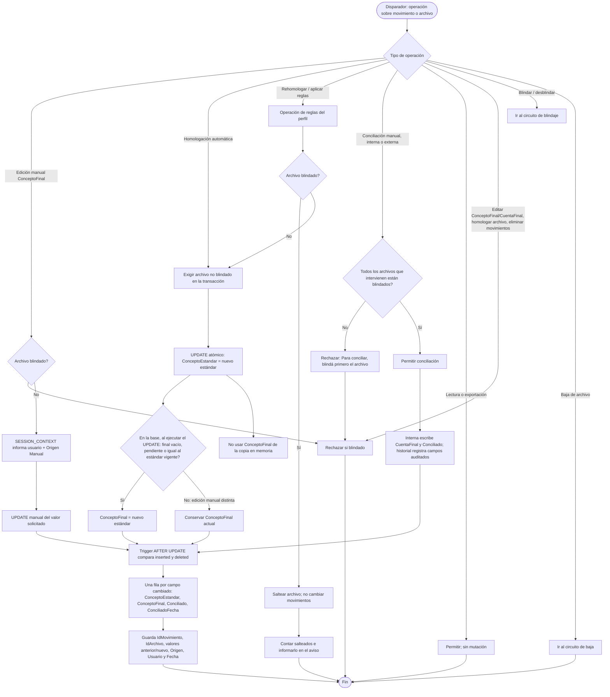
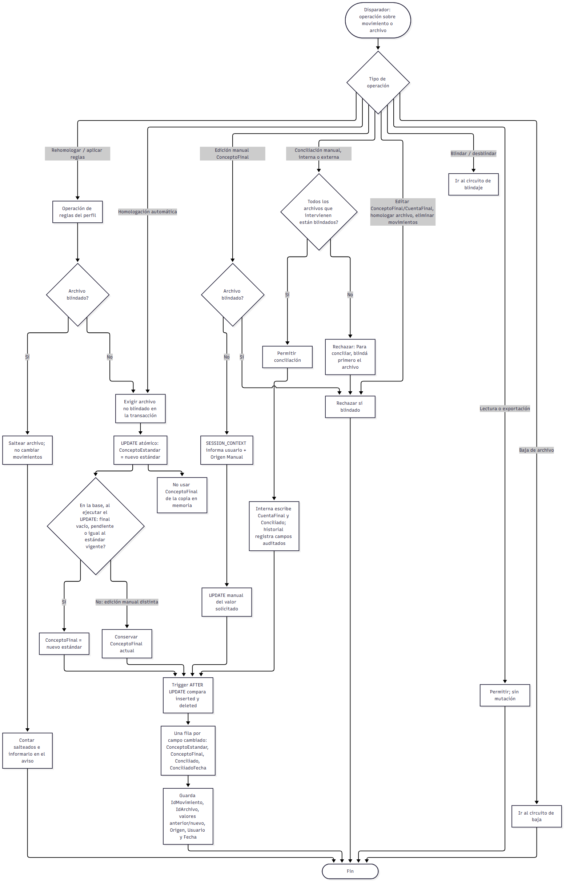
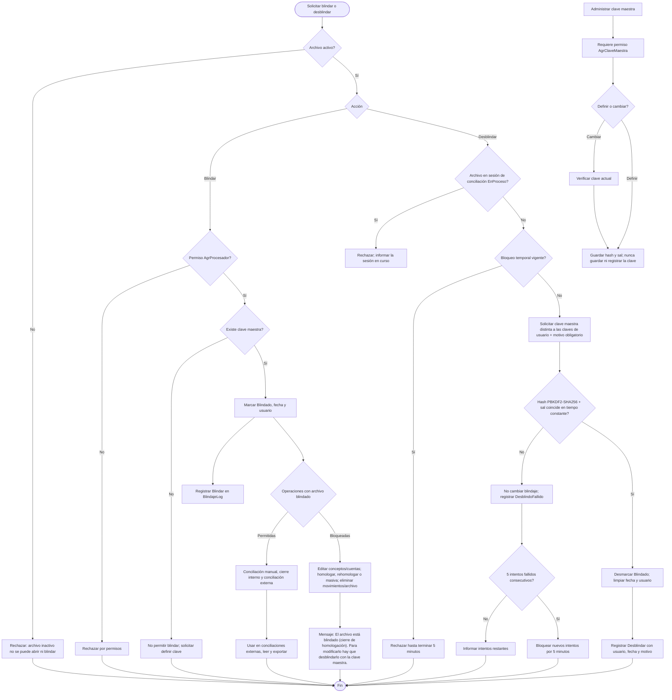
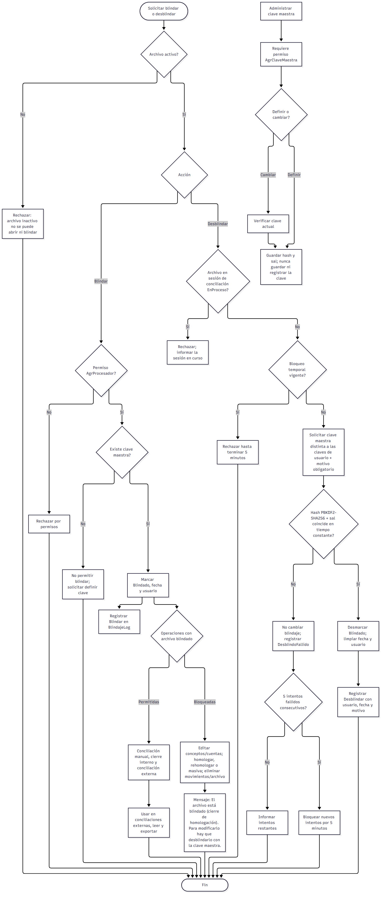
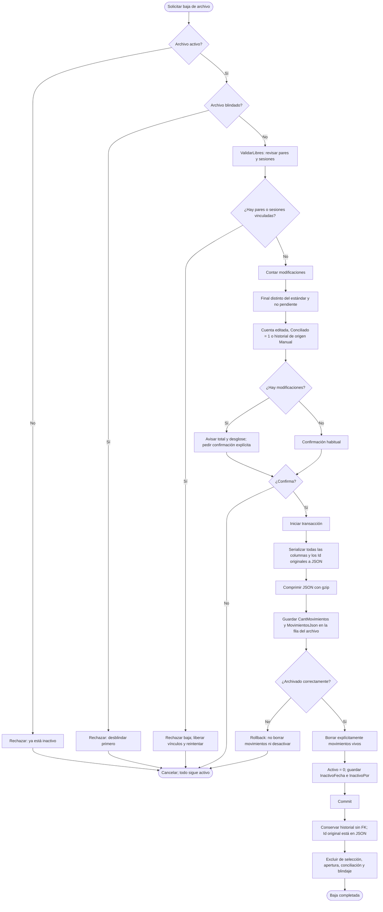
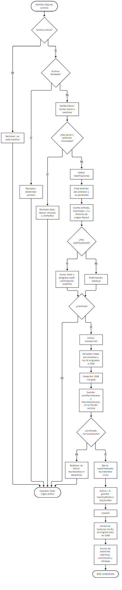

# TAREA 00135 — Concepto final protegido, historial de movimientos y blindaje de archivo

Módulo: `AgrupadorConceptos` (schema `bancos`), con sus dos anfitriones: el escritorio (`ProcesadorForm`) y la web (`Conciliador.Web`, `Procesador.razor`).

## Pedido (ítems)

1. **Concepto final protegido.** Chequear dónde se escribe `ConceptoFinal`. El usuario reporta haberlo editado y que en algunos casos volvió a quedar igual al concepto estándar. Ningún proceso automático puede modificarlo salvo que sea igual al `ConceptoEstandar` (o esté vacío/pendiente). Una edición manual nunca se pisa.
2. **Historial de cambios de `MovimientosArchivo`.** Tabla nueva que registra los cambios de `ConceptoEstandar`, `ConceptoFinal`, `Conciliado` y `ConciliadoFecha`.
3. **Blindaje del archivo (cierre de homologación).** Una marca del archivo, independiente del tilde de conciliado. Con el archivo blindado el usuario sólo puede **conciliar** (manual, interna o externa) y **usarlo en conciliaciones externas**. Todo lo demás se bloquea hasta que alguien lo **desblinde con la clave maestra**, distinta de la clave de cualquier usuario. A la inversa, **conciliar exige que el archivo esté blindado**.

## Auditoría del ítem 1 — quién escribe `ConceptoFinal` hoy

| # | Punto de escritura | Tipo | Observación |
|---|---|---|---|
| 1 | `MovimientoStorage.ActualizarConceptoFinal` (grilla de escritorio y web) | Manual | Es la única vía legítima. Escribe sin mirar el valor que había: si dos sesiones editan el mismo movimiento, gana la última. |
| 2 | `MovimientoStorage.UpdateConceptos` / `ActualizarConceptos` | Automático | **Causa principal.** El `UPDATE` escribe `ConceptoEstandar`, `ConceptoFinal` y `CuentaFinal` **desde el objeto en memoria**. Si esa copia está desactualizada (grilla abierta en otra sesión o pestaña, o diálogo de baja calculado antes de la edición), pisa en la base lo que el usuario editó y lo deja otra vez igual al estándar. |
| 3 | `HomologacionMatcher.EscribirConcepto` | Automático | Decide en memoria si el final "seguía al estándar". Es correcto sólo si la copia en memoria es fiel a la base (ver 2). |
| 4 | `SesionMovimientosService.RehomologarEnMemoria` | Automático | Trabaja sobre la lista en memoria (la más expuesta al problema del punto 2) y marca como "cambiados" a **todos** los pendientes aunque no hayan tenido match, o sea que los reescribe igual. |
| 5 | `SesionMovimientosService.ReaplicarHomologacion`, `RehomologarPendientes` | Automático | Mismo patrón. |
| 6 | `HomologacionAdminService.AplicarBaja` / `Reapuntar` → `HomologacionStorage.EliminarYActualizarMovimientos` / `ReapuntarYActualizarMovimientos` | Automático | La baja usa el impacto calculado cuando se abrió el diálogo y lo persiste después; si en el medio hubo una edición, se pierde. Alcanza a **todos los archivos del perfil**, no sólo al abierto. |
| 7 | `ImportacionService` (alta de movimientos) | Alta deliberada | Inicializa `ConceptoFinal` = estándar. No es causa del problema: importar o reimportar es una acción explícita y definitiva. |
| 8 | `SesionMovimientosService.RefrescarDesdeBase` | Sólo lectura | Copia de la base a memoria. No escribe en la base. |

**La causa a corregir es una sola: la escritura automática (puntos 2 a 6) con una copia desactualizada.** El alta y la baja de archivos o movimientos son acciones definitivas y deliberadas del usuario, y no entran en la causa (la baja de archivo se endurece aparte, ver más abajo). No se pudo reproducir el caso con los datos reales; la **tabla de historial (ítem 2) con origen del cambio** deja de ahí en adelante evidencia de qué proceso lo produjo.

### Regla nueva

Un proceso automático puede escribir `ConceptoFinal` **sólo si, en la base y en el momento de escribir**, el final está vacío / pendiente o es igual al `ConceptoEstandar` vigente. La condición se evalúa **en el `UPDATE`**, no en memoria, y los procesos automáticos **dejan de escribir `ConceptoFinal` desde el objeto**. Resultado: una copia vieja ya no puede pisar una edición.

```sql
-- patrón para los procesos automáticos (una sola sentencia, atómica)
UPDATE bancos.MovimientosArchivo
SET ConceptoFinal = CASE WHEN ConceptoFinal IS NULL OR ConceptoFinal = N''
                           OR ConceptoFinal = N'Pendiente Homologar'
                           OR ConceptoFinal = ConceptoEstandar
                         THEN @ConceptoEstandar ELSE ConceptoFinal END,
    ConceptoEstandar = @ConceptoEstandar
WHERE Id = @Id
```

La edición manual escribe el valor y registra `Origen = 'Manual'`. Los automáticos registran el proceso que los disparó.

Limitación que se acepta: si el usuario escribe a mano un final **idéntico** al estándar vigente, el sistema no puede distinguirlo de uno automático y un cambio posterior de regla lo va a mover. Es la regla pedida («sólo si es igual al estándar»).

## Modelo de datos

### `bancos.MovimientosArchivoHistorial` (ítem 2)

| Columna | Tipo | Nota |
|---|---|---|
| `Id` | `BIGINT IDENTITY` PK | |
| `IdMovimiento` | `INT NOT NULL` | **Sin FK**: el historial sobrevive a la baja del movimiento. |
| `IdArchivo` | `INT NOT NULL` | Para consultar por archivo. Sin FK, por lo mismo. |
| `Campo` | `NVARCHAR(30)` | `ConceptoEstandar`, `ConceptoFinal`, `Conciliado`, `ConciliadoFecha`. |
| `ValorAnterior` / `ValorNuevo` | `NVARCHAR(400) NULL` | Los cuatro campos viajan como texto. |
| `Origen` | `NVARCHAR(40)` | `Manual`, `Homologación`, `Re-homologación`, `Baja de regla`, `Reapuntar regla`, `Importación`, `Conciliación manual`, `Conciliación interna`, `Conciliación externa`, `Desconocido`. |
| `Usuario` | `NVARCHAR(100)` | Usuario de la aplicación; si no se informa, `SUSER_SNAME()`. |
| `Fecha` | `DATETIME2(0)` | `SYSDATETIME()`. |

Se llena con un **trigger `AFTER UPDATE`** sobre `bancos.MovimientosArchivo` que compara `inserted` con `deleted` y genera una fila por campo que cambió. Así quedan cubiertas todas las vías de escritura, incluidas las que se agreguen después. El origen y el usuario los informa el acceso a datos con `SESSION_CONTEXT` al abrir cada conexión (hay que re-informarlos en cada `Open`, porque el pool los limpia). El historial **no registra el alta inicial** del movimiento ni su baja; sólo los cambios. Índice por `IdMovimiento, Fecha`.

### Blindaje (ítem 3)

`bancos.ArchivosImportados` suma: `Blindado BIT NOT NULL DEFAULT 0`, `BlindadoFecha DATETIME2(0) NULL`, `BlindadoPor NVARCHAR(100) NULL`.

`bancos.BlindajeLog`: `Id`, `IdArchivo`, `Accion` (`Blindar` / `Desblindar` / `DesblindoFallido`), `Usuario`, `Fecha`, `Motivo` (obligatorio al desblindar). Los intentos fallidos también se guardan.

`bancos.ClaveMaestra` (una sola fila): `Hash`, `Sal`, `Iteraciones` (PBKDF2-SHA256), `FechaCambio`, `CambiadoPor`. Nunca se guarda ni se loguea la clave; se compara con tiempo constante. Si no hay fila, el sistema no permite blindar y pide definir la clave.

## Baja de archivo: aviso previo y archivo inactivo (ítem 1)

Hoy `EliminarArchivo` hace `DELETE` físico en `bancos.ArchivosImportados` y el `ON DELETE CASCADE` se lleva los movimientos. Cambia así:

- **Aviso previo.** Antes de confirmar la baja se calcula si el archivo tiene **modificaciones** y se muestra cuántas. Cuenta como modificado un movimiento que cumpla alguna de estas condiciones: `ConceptoFinal` distinto de `ConceptoEstandar` y no pendiente (edición manual), `CuentaFinal` editada, `Conciliado = 1`, o con filas de historial de origen `Manual`. El aviso dice, por ejemplo, «Este archivo tiene 128 movimientos con modificaciones (41 conceptos finales editados, 87 conciliados). ¿Dar de baja igual?» y exige confirmar. Un archivo sin modificaciones se da de baja con la confirmación de siempre.
- **El archivo no se borra: queda inactivo.** `bancos.ArchivosImportados` suma `Activo BIT NOT NULL DEFAULT 1`, `InactivoFecha DATETIME2(0) NULL`, `InactivoPor NVARCHAR(100) NULL`, `CantMovimientos INT NULL` y `MovimientosJson VARBINARY(MAX) NULL`. La baja pone `Activo = 0` y deja la fila, así el historial y el log siguen apuntando a un archivo que existe.
- **Los movimientos se archivan dentro de la fila del archivo.** En la misma transacción de la baja, todas las columnas de sus movimientos (incluido el `Id` original, `Conciliado`, `ConciliadoFecha`, `CuentaFinal`) se serializan a JSON, se comprimen con gzip y se guardan en `MovimientosJson`; después se borran de `bancos.MovimientosArchivo` (de forma explícita, porque el `CASCADE` ya no se dispara). Si el guardado falla, no se borra nada. Así ninguna consulta de movimientos necesita filtrar por archivo inactivo, y la tabla viva queda limpia y chica.
- **El historial de esos movimientos se conserva** (no tiene FK) y sigue apuntando a los `Id` originales, que están en el JSON. Restaurar un archivo (reinsertar los movimientos con sus `Id`) queda **fuera de esta tarea**, pero el formato lo permite.
- **Los listados de archivos muestran sólo los activos** (selección de archivo del procesador, conciliaciones, gestión de homologaciones). Un archivo inactivo no se puede abrir, conciliar ni blindar.
- Se mantienen las validaciones actuales de `ValidarLibres` (pares y sesiones de conciliación).
- Un archivo **blindado** no se puede dar de baja hasta desblindarlo.

## Reglas del blindaje

- **Blindar:** cualquier usuario con permiso `AgrProcesador` sobre un archivo no blindado. No pide clave. Queda en `BlindajeLog`.
- **Desblindar:** pide la clave maestra y un motivo. Con la clave incorrecta no hace nada y registra el intento; tras 5 intentos fallidos seguidos se bloquea 5 minutos.
- **Dónde se administra la clave maestra:** en el **ABM de usuarios del escritorio** (botón «Clave maestra del blindaje»), no en el procesador de archivos ni en la web: quien procesa archivos blinda y desblinda, pero no define ni cambia la clave. El procesador sólo muestra el estado del blindaje; si todavía no hay clave, blindar avisa dónde definirla. La maqueta `04-clave-maestra` es el diálogo que abre ese botón.
- **Cambiar la clave maestra:** pide la clave actual. Quién puede hacerlo se define con el permiso `AgrClaveMaestra`, y el servicio lo exige: sin permiso configurado por el anfitrión se rechaza (falla cerrado). La verificación de la clave y el conteo de intentos se serializan con un bloqueo de la base, así que no se pueden probar claves en paralelo (decisión 2).
- **Conciliar exige archivo blindado.** (En la externa se ofrecen sólo extractos blindados; la interna no elige archivos y rechaza el par, con el nombre del archivo, al conciliar o cerrar.) Ninguna conciliación (marcado manual, interna o externa) se puede hacer sobre un archivo sin blindar: el movimiento se concilia sobre una homologación ya cerrada. El blindaje es entonces el paso previo a conciliar, no sólo una restricción. En la interna y la externa, **todos** los archivos que intervienen tienen que estar blindados; si alguno no lo está, la operación se rechaza entera con el mensaje «Para conciliar, blindá primero el archivo: <nombre>.» y se ofrecen sólo archivos blindados al elegir. Es la misma guardia (`BlindajeStorage.ExigirBlindado`) que usan `MarcarConciliados`, el cierre de la interna y la externa, dentro de su transacción. Consecuencia: `Conciliado` y `ConciliadoFecha` sólo cambian en archivos blindados.
- **Desblindar un archivo en uso:** no se puede desblindar mientras el archivo esté en una sesión de conciliación `EnProceso`: en la externa, si la sesión lo incluye; en la interna, que no elige archivos, si algún movimiento del archivo cae en el rango y los conceptos de la sesión, tenga o no par (se avisa en qué sesión). Los movimientos ya conciliados siguen protegidos por la regla vigente («un movimiento conciliado no se edita») aunque el archivo se desblinde.
- **Permitido con el archivo blindado:** `MarcarConciliados` (manual), cierre y pares de la conciliación interna (que escribe `CuentaFinal` y `Conciliado` del movimiento al conciliar), conciliación externa, exportaciones y lectura.
- **Bloqueado con el archivo blindado:** editar `ConceptoFinal` y `CuentaFinal` en la grilla, homologar (alta, re-homologación y homologación masiva), `EliminarMovimientos` y `EliminarArchivo`.
- **Las reglas de homologación son del perfil, no del archivo.** Si se da de baja, se reapunta o se agrega una regla, los movimientos de **archivos blindados se saltean** (no cambian) y el aviso dice cuántos quedaron sin tocar. Los automáticos del ítem 1 también respetan el blindaje.
- **Dónde se aplica:** en un único punto, `BlindajeStorage.Exigir(cn, tx, idArchivo)`, que llama cada método de `MovimientoStorage` / `EliminacionMovimientosStorage` / `HomologacionStorage` que escribe, dentro de la misma transacción y con el bloqueo de mutaciones ya tomado. Los forms y la web no tienen SQL: sólo muestran el candado y el mensaje.
- El mensaje de bloqueo es siempre el mismo: «El archivo está blindado (cierre de homologación). Para modificarlo hay que desblindarlo con la clave maestra.»

## Orden de implementación

1. Esquema en `Data/SqlSchema.cs`: columnas de blindaje, `BlindajeLog`, `ClaveMaestra`, `MovimientosArchivoHistorial` y su trigger (idempotente, como el resto del archivo).
2. Contexto de auditoría en el acceso a datos (`SESSION_CONTEXT` de usuario y origen). Verificar dónde vive `DatabaseHelper`.
3. **Ítem 1:** reescribir `UpdateConceptos` / `ActualizarConceptos` con la condición en SQL; `ActualizarConceptoFinal` pasa a ser la vía manual explícita. Ajustar `RehomologarEnMemoria` para que sólo marque los que de verdad cambian.
4. `BlindajeStorage` + `BlindajeService` (blindar, desblindar, clave maestra, bloqueo por intentos), con pruebas sobre el hash y los intentos.
5. Enganchar `Exigir` (no blindado) en los métodos de escritura listados, `ExigirBlindado` en `MarcarConciliados` y en el cierre de la conciliación interna y externa, el bloqueo de desblindar con sesión en proceso, y el salteo de archivos blindados en las operaciones por perfil.
6. Baja de archivo inactivo: columnas nuevas, conteo de modificaciones, `EliminarArchivo` que archiva los movimientos en el JSON comprimido, los borra y desactiva el archivo, y filtro de activos en los listados de archivos.
7. Pantallas: candado y botones en el procesador (escritorio y web), aviso de baja con modificaciones, diálogo de desblindar, pantalla de clave maestra, consulta de historial por movimiento.
8. Pruebas: (a) una copia en memoria vieja no pisa una edición manual; (b) cada método bloqueado rechaza si el archivo está blindado y los permitidos pasan; (c) el trigger genera una fila por campo con su origen; (d) conciliar un archivo sin blindar se rechaza en las tres vías (manual, interna y externa), y con uno solo de los archivos sin blindar se rechaza todo sin cambiar nada; no se puede desblindar con una sesión en proceso; clave incorrecta, bloqueo por intentos y cambio de clave; (e) la baja con modificaciones avisa, deja el archivo inactivo, archiva sus movimientos en el JSON (descomprimido y comparado fila por fila con los originales), los quita de la tabla viva y conserva su historial; si falla el archivado, no se borra nada.
9. Actualizar esta guía si lo construido se desvía.

## Decisiones abiertas

1. **Retroactivo:** el historial arranca vacío; lo ya pisado no se recupera salvo un respaldo de la base. ¿Hay un respaldo anterior del que se pueda comparar `ConceptoFinal`?
2. **Quién administra la clave maestra** y **quién puede blindar**: propongo permisos nuevos `AgrClaveMaestra` y reutilizar `AgrProcesador` para blindar.
3. **Blindar al importar:** hoy se blinda a mano. ¿Algún caso en que deba blindarse solo (por ejemplo al finalizar una conciliación)? Propongo que no.
4. ~~Movimientos del archivo inactivo~~ — **resuelta**: se archivan como JSON comprimido en la fila del archivo y se quitan de la tabla viva.
5. **Edición de `CuentaFinal`** con el archivo blindado: se bloquea la edición en grilla; sólo cambia al conciliar internamente. Confirmar.

## Flujograma

Circuito completo desde el disparador hasta el cierre. Los tres diagramas cubren la escritura e historial, el blindaje y sus permisos, y la baja transaccional.

### 1. Escrituras e historial de movimientos




### 2. Blindar, desblindar y operaciones permitidas o bloqueadas




### 3. Baja de archivo




## Maquetas

Una sola maqueta por pantalla, válida para el escritorio y la web, con datos de ejemplo realistas.

- `01-procesador-blindado.png` — grilla del procesador con el archivo blindado: candado, columnas de concepto final y cuenta bloqueadas, botones Conciliar habilitados y Homologar/Eliminar deshabilitados.
- `01-procesador-blindado-vacio.png` — archivo sin movimientos visibles por el filtro.
- `01-procesador-sin-blindar.png` — archivo sin blindar: los botones de conciliación deshabilitados con el aviso «Para conciliar, blindá primero el archivo», y el botón Blindar habilitado.
- `01-procesador-blindado-error.png` — intento de editar un movimiento de un archivo blindado, con el mensaje de bloqueo.
- `06-conciliacion-archivo-sin-blindar-error.png` — conciliación interna o externa rechazada porque uno de los archivos elegidos no está blindado: nombre del archivo y mensaje.
- `02-desblindar.png` — diálogo de desblindar: clave maestra y motivo.
- `02-desblindar-error.png` — clave incorrecta, intentos restantes y bloqueo temporal.
- `05-baja-archivo-aviso.png` — confirmación de baja de un archivo con modificaciones: conteo por tipo y botón de confirmar.
- `05-baja-archivo-aviso-error.png` — baja rechazada por archivo blindado o por pares de conciliación.
- `03-historial-movimiento.png` — historial de un movimiento: fecha, campo, anterior, nuevo, origen y usuario.
- `03-historial-movimiento-vacio.png` — movimiento sin cambios registrados.
- `04-clave-maestra.png` — definir o cambiar la clave maestra.
- `04-clave-maestra-error.png` — clave actual incorrecta o confirmación que no coincide.
