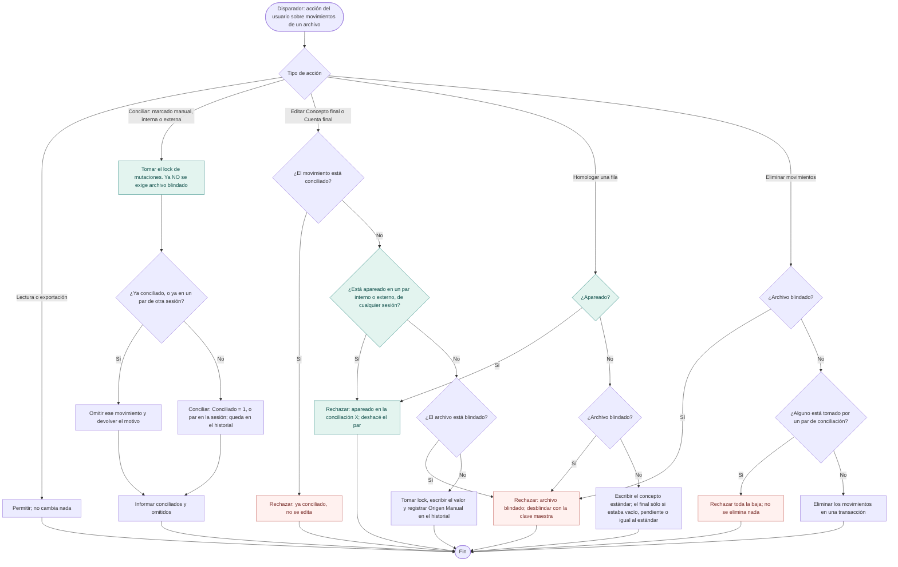
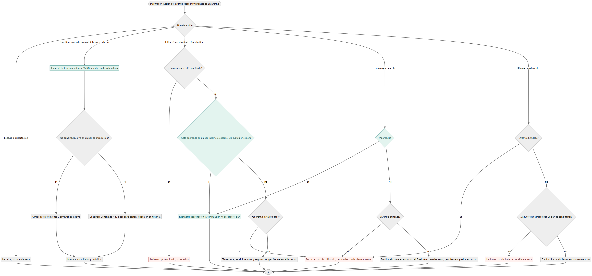
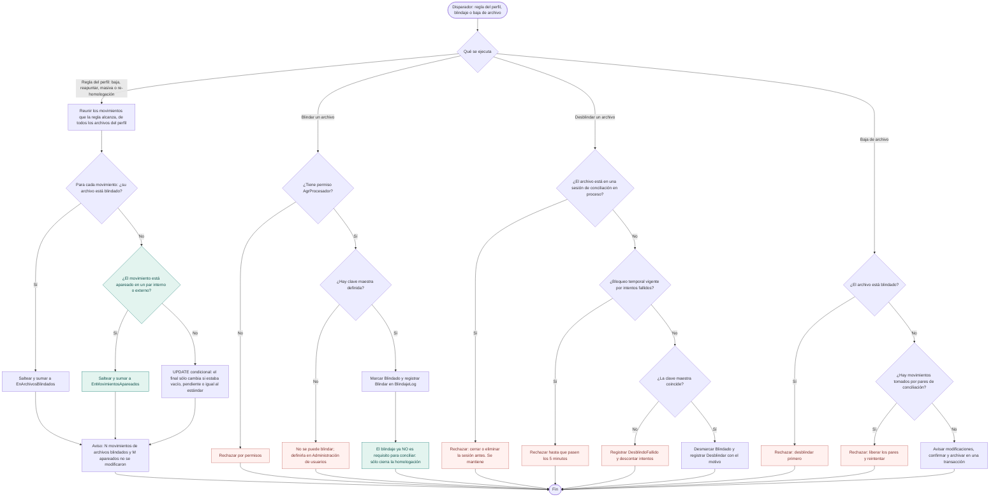
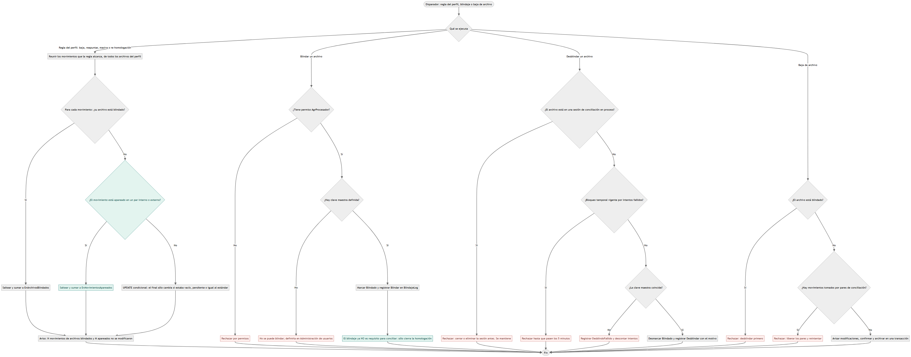

# TAREA 00162 — Conciliar sin blindar, y los movimientos apareados no se tocan

Módulo: `AgrupadorConceptos` (schema `bancos`), con sus dos anfitriones: el escritorio
(`ProcesadorForm`, `ConciliacionExternForm`, `ConciliacionInternaForm`, `GestionHomologacionesForm`) y la
web (`Conciliador.Web`: `Procesador.razor`, `ConciliacionExterna.razor`, `Homologaciones.razor`).

Revisa dos reglas que puso la TAREA 00135 (`docs/Diseño/00135-blindaje-historial/blindaje-historial.md`):
el blindaje deja de ser requisito para conciliar, y la protección de lo ya apareado —hoy parcial— pasa a ser
la regla fuerte. **El blindaje no se elimina:** sigue existiendo, se blinda y se desblinda igual, y un archivo
blindado sigue bloqueando todo lo que bloqueaba. Lo único que se saca es la exigencia de blindar para conciliar.

## Pedido (ítems)

1. **Conciliar sin blindar.** Hoy conciliar exige que todos los archivos que intervienen estén blindados
   (`BlindajeStorage.ExigirBlindados*`), en las tres vías: marcado manual, conciliación interna y externa.
   Esa exigencia se elimina: se concilia esté el archivo blindado o no.
2. **Un movimiento apareado no se toca, aunque la conciliación no esté cerrada.** En el procesador del
   escritorio y en el de la web, un movimiento que figura en un par de conciliación —interna o externa, en
   proceso o finalizada— no se puede editar, eliminar, rehomologar ni marcar como conciliado a mano. No depende
   del estado de la sesión ni de que la sesión siga existiendo.

## Qué cambia respecto de la 00135

| Regla de la 00135 | Queda así |
|---|---|
| «Conciliar exige archivo blindado» (manual, interna y externa) | **Se elimina.** Se concilia con el archivo blindado o sin blindar. |
| La externa ofrece sólo extractos blindados y avisa cuántos oculta | **Se elimina el filtro.** Se ofrecen todos los extractos del rango; el blindaje se sigue mostrando como dato. |
| Botones de conciliar deshabilitados mientras el archivo no esté blindado | **Habilitados siempre** (salvo las validaciones que no son de blindaje: proceso en curso, nada seleccionado). |
| Un archivo blindado bloquea editar, homologar, eliminar movimientos y la baja del archivo | **Sin cambios.** |
| Blindar / desblindar con clave maestra, log e intentos | **Sin cambios.** |
| «Un movimiento conciliado no se edita» (`Conciliado = 1`) | **Sin cambios**, y ahora es redundante con la regla nueva en la mayoría de los casos (el marcado manual no deja par). |
| La `CuentaFinal` de un movimiento en una sesión interna `EnProceso` no se edita | **Se generaliza** (ítem 2): alcanza también a `ConceptoFinal`, a los pares externos y a las sesiones finalizadas. |

## Modelo de datos

**No hay tablas ni columnas nuevas.** La condición «apareado» se lee de las dos tablas de pares que ya existen:

| Tabla | Columna con el movimiento | Vía |
|---|---|---|
| `bancos.ConciliacionPares` | `IdMovimientoProcesado` | Conciliación externa |
| `bancos.ConciliacionInternaPares` | `IdMovimientoA`, `IdMovimientoB` | Conciliación interna |

Ninguna de las dos tiene FK al movimiento, así que un par sobrevive a la baja de su sesión: es justamente lo que
hace que la protección no dependa del estado de la sesión.

Se agregan índices en `Data/SqlSchema.cs` (idempotentes, como el resto del archivo), porque la consulta nueva
busca por movimiento y hoy los índices son por sesión:

```sql
IF NOT EXISTS (SELECT 1 FROM sys.indexes WHERE name = N'IX_ConciliacionPares_IdMovimiento')
    CREATE INDEX IX_ConciliacionPares_IdMovimiento ON bancos.ConciliacionPares(IdMovimientoProcesado);
-- Los pares internos tienen UX_..._MovimientoA / _MovimientoB sobre (IdSesion, IdMovimiento): sirven para
-- buscar por sesión, no por movimiento, así que hace falta uno por movimiento de cada lado.
IF NOT EXISTS (SELECT 1 FROM sys.indexes WHERE name = N'IX_ConciliacionInternaPares_MovA')
    CREATE INDEX IX_ConciliacionInternaPares_MovA ON bancos.ConciliacionInternaPares(IdMovimientoA);
IF NOT EXISTS (SELECT 1 FROM sys.indexes WHERE name = N'IX_ConciliacionInternaPares_MovB')
    CREATE INDEX IX_ConciliacionInternaPares_MovB ON bancos.ConciliacionInternaPares(IdMovimientoB);
```

`Models/MovimientoProcesado` suma dos propiedades **que no están en la tabla** y que la grilla usa para mostrar el
estado: `Apareado` (bool) y `ApareadoEn` (texto: `conciliación interna «<sesión>»`, `conciliación externa «<sesión>»`,
o `una conciliación` si la sesión ya no existe). Se completan al cargar los movimientos del archivo, con una sola
consulta por carga; no se persisten. La grilla del escritorio oculta `ApareadoEn` como columna (igual que `Id` e
`IdArchivo`) y muestra el estado en la columna descrita en las maquetas.

## Reglas

### Ítem 1 — conciliar sin blindar

- Desaparecen `BlindajeStorage.ExigirBlindados` y `ExigirBlindadosPorMovimientos`, y con ellas la excepción
  `ArchivoSinBlindarException` y el mensaje «Para conciliar, blindá primero el archivo: …». Se eliminan sus seis
  llamadas: `MovimientoStorage.MarcarConciliados`, `ConciliacionExternStorage` (alta de sesión, finalizar, conciliar
  par) y `ConciliacionInternaMutationStorage` (conciliar par, finalizar).
- La elección de extractos de la conciliación externa vuelve a ofrecer **todos** los candidatos del rango
  (escritorio y web). Se saca el conteo «N sin blindar no se ofrecen» y la validación previa al armar la sesión.
  El estado de blindaje se sigue mostrando por extracto, como dato.
- Los botones «Marcar como conciliados» del procesador dejan de pedir `Blindado`, y el aviso que decía «Para
  conciliar, blindá primero el archivo» se reemplaza por el texto de las maquetas.
- **Lo que sigue bloqueado con el archivo blindado no se toca:** editar `ConceptoFinal` / `CuentaFinal`, homologar
  (alta, re-homologación y masiva), `EliminarMovimientos`, `EliminarArchivo`, y el salteo de archivos blindados en
  las operaciones de reglas del perfil. Mismo mensaje de siempre.
- Tampoco se toca el bloqueo de **desblindar un archivo que está en una sesión de conciliación en proceso**
  (decisión D1): protege el alcance de una sesión viva, que es un motivo propio y sigue valiendo.

### Ítem 2 — el movimiento apareado no se toca

- **Definición única.** Un movimiento está apareado si figura en `bancos.ConciliacionPares` o en
  `bancos.ConciliacionInternaPares`. No importa el estado de la sesión (`EnProceso`, `Finalizada`) ni que la sesión
  ya no exista. Es el mismo criterio que usa hoy la baja de archivos y movimientos (`ValidarLibres`).
- **Un solo lugar decide.** `Data/ParesMovimientoStorage.cs` (nuevo):
  - `ExigirSinPar(cn, tx, ids)` — rechaza con `MovimientoApareadoException` si alguno de los ids está apareado;
    se llama **dentro de la transacción del llamador y con el lock de mutaciones ya tomado**, como las guardias de
    blindaje, para que no se pueda saltear con una escritura concurrente.
  - `ObtenerApareados(ids)` / `ObtenerApareadosPorArchivo(idArchivo)` — devuelve id → dónde está apareado, para que
    la grilla marque las filas y para contar los salteados de una operación de reglas.
- **Operaciones que pasan a rechazar** (las cuatro que pidió el pedido):

  | Operación | Dónde | Qué hace |
  |---|---|---|
  | Editar `ConceptoFinal` | `MovimientoStorage.ActualizarConceptoFinal` | `ExigirSinPar` → rechaza |
  | Editar `CuentaFinal` | `MovimientoStorage.ActualizarCuentaFinal` | `ExigirSinPar` → rechaza (reemplaza el chequeo acotado a sesiones internas `EnProceso`) |
  | Eliminar movimientos | `EliminacionMovimientosStorage.ValidarLibres` | **ya lo hace**: se mantiene y se cubre con prueba |
  | Marcar como conciliado a mano | `MovimientoStorage.MarcarConciliados` | **ya lo hace**: vuelve en `Omitidos` con el motivo; se mantiene |

- **Operaciones de homologación: saltean, no rechazan.** Una regla es del perfil y alcanza muchos archivos; cortar
  todo por un movimiento apareado dejaría la regla sin aplicar. Mismo patrón que el blindaje (decisión D3):
  - `MovimientoStorage.ActualizarConceptos` agrega al `UPDATE` la condición de que el movimiento no esté apareado,
    igual que la de archivo no blindado, y no cuenta los salteados como escritos.
  - `HomologacionAdminService.AplicarBaja` y `Reapuntar` saltean los apareados y los cuentan aparte:
    `ImpactoHomologacion` suma `EnMovimientosApareados` y los avisos del escritorio y de la web informan «N
    movimiento(s) apareados en una conciliación no se modificaron», junto al aviso de blindados que ya existe.
  - La homologación manual de una fila del procesador (que escribe sobre un movimiento puntual) sí **rechaza**:
    es una acción sobre ese movimiento, no sobre el perfil.
- **Pantallas.** El procesador marca las filas apareadas y no deja entrar en edición en `ConceptoFinal` ni en
  `CuentaFinal`; el mensaje es siempre el mismo y dice dónde está apareado:

  > Este movimiento está apareado en una conciliación interna/externa («<sesión>») y no se puede modificar.
  > Deshacé el par en esa conciliación si hay que cambiarlo.

  En el escritorio, `DgvDatos_CellBeginEdit` cancela la edición; en la web, `CambioConceptoFinal` /
  `CambioCuentaFinal` revierten el valor y muestran el error. La condición se mira sobre los datos cargados (una
  consulta por carga de archivo, no una por celda); el storage la vuelve a exigir en la transacción.
- El tilde `Conciliado` y el blindaje siguen bloqueando lo que ya bloqueaban: la regla nueva se suma, no reemplaza.

## Orden de implementación

1. `Data/ParesMovimientoStorage.cs`: `ExigirSinPar`, `ObtenerApareados`, `ObtenerApareadosPorArchivo`,
   `MovimientoApareadoException`. Índices nuevos en `Data/SqlSchema.cs`.
2. Ítem 1 en el acceso a datos: borrar `ExigirBlindados*` y `ArchivoSinBlindarException` y sus seis llamadas.
3. Ítem 2 en el acceso a datos: `ExigirSinPar` en las dos ediciones puntuales; condición de par en
   `UpdateConceptos`; `EnMovimientosApareados` en `ImpactoHomologacion` y el salteo en `HomologacionAdminService`.
4. `Models/MovimientoProcesado`: `Apareado` / `ApareadoEn`, y completarlas al cargar los movimientos del archivo.
5. Pantallas del escritorio: `ProcesadorForm` (botones sin `Blindado`, columna de apareado, `CellBeginEdit`,
   homologación de una fila), `ConciliacionExternForm` (sin filtro ni aviso de sin blindar),
   `ConciliacionInternaForm` y `GestionHomologacionesForm` (aviso de apareados).
6. Pantallas de la web: `Procesador.razor` / `.razor.cs`, `ConciliacionExterna.razor`, `Homologaciones.razor`.
7. Pruebas: (a) conciliar (manual, interna y externa) con el archivo **sin** blindar ahora pasa, y con el archivo
   blindado también; (b) editar `ConceptoFinal` o `CuentaFinal` de un movimiento apareado se rechaza, con la sesión
   en proceso, finalizada y borrada, y en los dos tipos de par; (c) un movimiento libre del mismo archivo sí se
   edita; (d) eliminar y marcar como conciliado un apareado se siguen rechazando; (e) una regla que alcanza un
   apareado no lo modifica y lo informa en el conteo; (f) con el archivo blindado se siguen rechazando las
   ediciones, la homologación y las bajas. Se ajustan las pruebas de la 00135 que afirmaban lo contrario
   (`Tools/AgrupadorWeb.Tests/BlindajeTests.cs`, `ConciliacionExternaTests.cs`, `ConciliacionInternaTests.cs`,
   `Tools/Homologador.Tests/ConciliacionSeguraTests.cs`).
8. Actualizar la guía de la 00135 para que no quede afirmando que conciliar exige blindaje (una nota que apunte a
   esta guía en las reglas afectadas), y esta guía si lo construido se desvía.

## Decisiones

| # | Decisión | Propuesta |
|---|---|---|
| D1 | Desblindar un archivo que está en una sesión de conciliación en proceso | **Se mantiene bloqueado.** El motivo original («después esa sesión no podría conciliarlo») ya no aplica, pero sigue valiendo otro: desblindar habilita editar conceptos de movimientos que están en el alcance de una sesión viva y le cambia el resultado. Es el cambio más chico y no quita nada que el usuario pueda hacer hoy. |
| D2 | Cómo se ve «apareado» en la grilla | Columna nueva de sólo lectura en el escritorio y una marca en la columna «Conciliado» de la web, con el detalle (interna/externa y sesión) en el mensaje de bloqueo. Lo fija la maqueta `01-procesador-apareado`. |
| D3 | Las operaciones de reglas del perfil (baja, reapuntar, masiva) ante un apareado | **Saltean y cuentan**, como con los archivos blindados, en vez de cortar toda la operación. Una regla alcanza varios archivos y abortarla por un movimiento dejaría el resto sin homologar. |
| D4 | Movimientos apareados que hoy tienen el concepto final editado | No se corrige nada retroactivo: la regla es de acá en adelante. El historial de la 00135 ya deja rastro de quién editó qué. |

## Flujograma

En verde lo que cambia en esta tarea; en rojo, los rechazos. Son dos diagramas: el primero cubre las acciones
sobre movimientos puntuales y el segundo las reglas del perfil, el blindaje y la baja de archivo.

### 1. Acciones sobre movimientos





### 2. Reglas del perfil, blindaje y baja de archivo





## Maquetas

Una maqueta por pantalla que cambia, con datos de ejemplo realistas.

- `00-flujograma.png` y `00-flujograma-02.png` — el circuito completo, partido en dos diagramas (ver arriba).
- `01-procesador-sin-blindar.png` — procesador con el archivo **sin blindar**: badge «Archivo sin blindar»,
  botón «Blindar archivo» disponible y **«Marcar como conciliados» habilitado**, sin ningún aviso de que haya que
  blindar antes.
- `01-procesador-apareado.png` — grilla con filas apareadas marcadas (interna y externa), sus celdas de concepto y
  cuenta final en modo no editable, y filas libres editables en el mismo archivo.
- `01-procesador-apareado-error.png` — intento de editar un movimiento apareado: el mensaje con la vía y la sesión.
- `01-procesador-apareado-vacio.png` — archivo cuyos movimientos visibles están todos apareados: nada editable y el
  texto que lo explica.
- `02-conciliacion-externa-eleccion.png` — elección de extractos: se ofrecen todos los del rango, blindados y sin
  blindar, con el blindaje como dato de cada fila y sin el aviso «N sin blindar no se ofrecen».
- `02-conciliacion-externa-eleccion-vacio.png` — el rango no tiene extractos (estado vacío real, no «ninguno está
  blindado»).
- `03-homologaciones-aviso-apareados.png` — aviso al dar de baja o reapuntar una regla: cuántos movimientos no se
  modificaron por estar apareados y cuántos por estar en archivos blindados.
