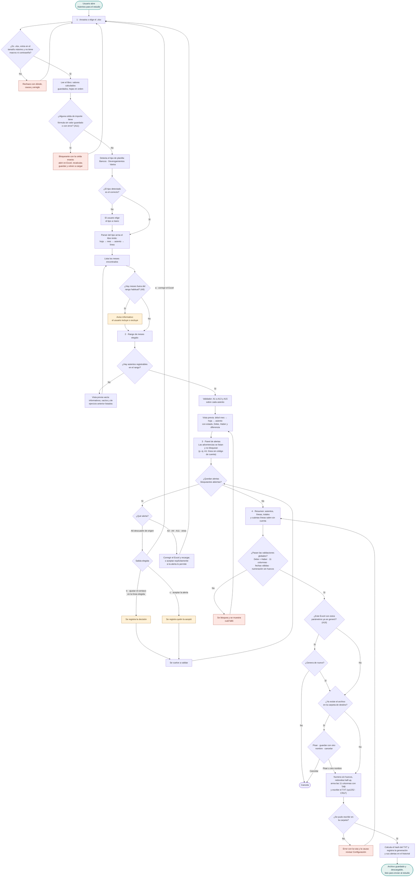

# TAREA 00180 — Asientos para el estudio contable

Herramienta que lee planillas Excel con asientos armados por el área contable, las valida y genera un TXT con
separador TAB para importar en **Holistor Contable** («Archivo Único de Movimientos», una columna Debe y otra Haber),
listo para enviar al estudio contable.

Hoy ese proceso se hace a mano, con scripts. La herramienta lo vuelve repetible, auditable y capaz de detectar los
errores antes de mandar el archivo.

> **Fuente del pedido:** `docs/PROMPT_HERRAMIENTA_ASIENTOS_ESTUDIO.md` (el pedido textual y el catálogo completo de
> alertas A1–A16 con sus casos reales). Esta guía **no lo repite**: lo ordena en ítems, lo aterriza en este repo y
> fija las decisiones. Si algo de este `.md` y del prompt se contradicen, se pregunta antes de decidir.
> Los números de sección que se citan (§3, §4.1, §6…) son los del prompt.

## Pedido (ítems)

| Ítem | Contenido | Prompt |
|---|---|---|
| 1 | Parser **BANCOS**: una hoja por banco, marcador `MES mm/aaaa`, asientos `ASIENTO n`, exclusión de los informativos | §4.1 |
| 2 | Parser **DEVENGAMIENTOS**: una hoja por mes `MM-AAAA`, el concepto es el texto del encabezado | §4.2 |
| 3 | Parser **VARIOS**: hojas por circuito, varios meses por hoja, dos formatos de mes, notas que se ignoran | §4.3 |
| 4 | **Detección del tipo de planilla** (editable) y **selección de meses** (rango, mes fuera de rango, A9) | §2, §5 |
| 5 | **Validaciones y catálogo de alertas** A1–A16 (con los cambios de la sección siguiente): línea sin cuenta como advertencia, regla del centavo, aceptación explícita de bloqueantes, listado exportable | §6 |
| 6 | **Generación del TXT** de Holistor: 11 columnas TAB, numeración, redondeo `decimal`, cp1252 + CRLF, carpeta y nombre de destino | §3 |
| 7 | **Historial y auditoría**: hash del Excel y del TXT, usuario, parámetros, alertas aceptadas, aviso de archivo ya generado (A16) | §7, §8 |
| 8 | **Configuración y robustez**: parámetros del TXT, validación del archivo subido (`.xlsx`, tamaño, sin macros) | §3, §8 |

## Cambios respecto del prompt (decididos por quien hizo el pedido, 12/11/2026)

Después de ver las maquetas se ajustó el alcance. **Estos puntos pisan al prompt:**

1. **No hay mapeo nombre → cuenta.** El prompt lo pedía en A1 y en §8; se saca entero: sin pantalla de mapeo, sin tabla
   `asientos.MapeoCuentas`, sin lista de mapeos en Configuración.
2. **Una línea sin código de cuenta (A1) es una advertencia, no un bloqueante.** Se avisa dónde está (hoja, mes, asiento,
   fila, nombre de la cuenta) y cuántas son, y el TXT sale con el campo cuenta vacío en esas líneas. No hace falta aceptar
   nada para generar. Aparece en la vista previa, en el panel de alertas, en el resumen y en el historial.
3. **No se valida contra ningún plan de cuentas.** Las cuentas locales (`bancos.CuentasContables`) son del Agrupador y
   sirven **sólo para completar tareas del homologador**: esta herramienta no las lee. **A14 queda fuera de esta
   tarea.** El código se toma tal cual del Excel; A2 sólo normaliza el formato (`4,01,05,050` → `4.01.05.050`) y, si
   después de normalizar no tiene forma de código (dígitos separados por puntos), es bloqueante.

### Precisiones que salieron al implementar (13/11/2026)

Al comparar contra los tres Excel reales y los TXT que ya se habían generado a mano, el prompt resultó impreciso en tres puntos. Se resolvieron
así, y los tests de aceptación los fijan:

4. **El ajuste de centavo de A5 se hace del lado del Debe.** El prompt dice «la línea cuyo residuo de redondeo sea el mayor en la dirección
   correcta», sin decir el lado. En los cuatro casos reales el estudio ajustó siempre una línea del Debe (RICARDO +0,01 ×2, IMP A LOS DEB Y CRED COMP
   −0,01 y DEUDORES POR VENTAS +0,01). Elegir la mejor línea de cualquiera de los dos lados da otra línea en VENTAS 07/2026 y mueve el total
   del archivo un centavo (71.914.422.835,05 pasaría a ,04), que ya no coincidiría con lo importado. El Haber queda solo de respaldo.
5. **A2: son 1 línea y no 3.** El prompt habla de 3 líneas con `4,01,05,050`; en el Excel hay una sola con coma (COMPRAS mayo, fila 70). Las
   otras dos líneas de la cuenta ASSAL (julio y agosto) ya traen puntos.
6. **Se agrega «M1» (asiento sin mes), bloqueante.** El bloque del ejercicio anterior queda antes del primer marcador de mes y no tiene mes, pero no
   se registra. Un asiento a registrar sin mes no tiene fecha para el TXT, así que bloquea.

Consecuencia en los criterios de aceptación de §7: la versión anterior del Excel de BANCOS sigue dando **15 alertas A1**,
ahora de severidad *Advertencia*, y el TXT se genera igual con esas 15 líneas sin cuenta. Los códigos que figuran en §7
para COMAFI BURSATIL, SANTANDER VALORES, etc. eran los que el contador agregó al Excel; la herramienta no los asigna.

## Dónde vive (decisión D1 — a confirmar)

El repo ya reparte así: los módulos son bibliotecas con la lógica y el acceso a datos, y los dos anfitriones (el shell
WinForms `ConciliadorContable` y `Conciliador.Web`) las usan. Ejemplos: `ArcaCliente.Core` y `AgrupadorConceptos.Core`.

**Propuesta:**

- **Proyecto nuevo `AsientosEstudio.Core`** (net8.0, sin UI): lector de Excel, parsers, validador, generador del TXT y
  acceso a datos (`Data/*Storage.cs`, schema `asientos`). Referencia `Conciliador.Comun` (conexión) y `ClosedXML`,
  ya usado en `ArcaCliente.Core`. Tests en `Tools/AsientosEstudio.Tests`.
- **Anfitrión: la web (`Conciliador.Web`).** Cargar un `.xlsx`, ver un árbol con estados y trabajar un panel de alertas
  es un trabajo de pantalla ancha que la web resuelve mejor que un form de WinForms. Entra al menú con un permiso propio
  (`Asientos.*` en `Security/Permisos.cs`).
- **El escritorio queda fuera de esta tarea**, pero como `Core` no tiene UI se le puede sumar un anfitrión después sin
  tocar nada del núcleo.

Alternativas: sólo escritorio (formularios Telerik) o ambos a la vez. Ambos duplica el trabajo de pantallas.

## Reglas heredadas del prompt (no se repiten acá)

Todo lo que dicen **§3 (formato de salida)**, **§4 (perfiles)**, **§5 (meses)** y **§6 (alertas A1–A16)** rige tal cual, salvo lo de la sección anterior.
Lo que sí se fija acá:

1. **Los importes son `decimal`.** Nunca `double`. Redondeo `MidpointRounding.AwayFromZero` a 2 decimales por línea.
   La regla del centavo (A5 vs A6) se evalúa **sobre la suma sin redondear**.
2. **Los valores salen del valor calculado guardado en el `.xlsx`**, no se recalcula (A11). Se verifica en la etapa 1
   que `ClosedXML` expone ese valor (`CachedValue`) tal como el prompt lo necesita; si no, se lee el XML de la hoja.
3. **Todo importe y fecha se lee sin depender de la cultura de la máquina** (el mismo error que ya costó la TAREA 00083
   y el commit `598464c` de DataPipeline). Los tests corren bajo `es-AR` y bajo `InvariantCulture`.
4. **Las planillas no tienen estructura rígida:** se detecta por patrones de texto, nunca por número de fila.
5. **Ninguna alerta se resuelve en silencio.** Cada decisión (ajuste de centavo, aceptación) queda en el
   historial con quién la tomó.

## Arquitectura

```
Excel (.xlsx)
   │  LectorLibro            valores calculados, hojas en orden, sin macros
   ▼
IAsientoParser  ← Bancos | Devengamientos | Varios     (una estrategia por tipo, tests propios)
   │  produce un LibroLeido: Hoja → Mes → Asiento → Línea (con hoja y fila de origen en cada línea)
   ▼
Validador                reglas A1–A13 y A15 sobre el LibroLeido → lista de Alertas
   ▼
Resolución               ajuste de centavo · aceptaciones   (decisiones del usuario)
   ▼
PlanDeSalida             filtra meses, excluye informativos/vacíos, numera sin huecos
   ▼
GeneradorTxt             11 columnas TAB, CRLF, cp1252/UTF-8, half-up
   ▼
Guardado + Historial     carpeta de destino, hash del TXT, alertas aceptadas, A16
```

Agregar un tipo de planilla = una clase nueva que implementa `IAsientoParser` y se registra en la lista del detector.
No toca a los otros.

### Modelo en memoria

| Tipo | Contenido |
|---|---|
| `LibroLeido` | tipo de planilla, hash del Excel, hojas, alertas del parseo |
| `HojaLeida` | nombre, orden, meses |
| `AsientoLeido` | hoja, mes, número de origen, **concepto**, estado (`Registrable` / `InformativoExcluido` / `VacioOmitido` / `NoSeRegistra`), línea de encabezado en el Excel, líneas |
| `LineaLeida` | fila del Excel, código, nombre, debe, haber (sin redondear) |
| `Alerta` | código `A1`…`A16`, severidad (`Bloqueante` / `Advertencia` / `Informativa`), hoja, mes, asiento, fila, cuenta o nombre, causa, acción de resolución, estado (`Abierta` / `Resuelta` / `Aceptada`), quién y cuándo |

## Modelo de datos (SQL Server, base `alvesu`, schema `asientos`)

Creado desde `Data/SqlSchema.cs` del módulo, idempotente, con el comentario de versionado `--` en cada bloque, como el
resto del repo. El módulo se auto-inicializa: abrir cualquier pantalla alcanza.

```sql
asientos.Configuracion (
    Clave  NVARCHAR(60)  PRIMARY KEY,
    Valor  NVARCHAR(400) NOT NULL )
-- CarpetaDestino, Codificacion (cp1252|utf8), FormatoFecha (dd/mm/aaaa|aaaammdd),
-- Numeracion (global|reinicia por fecha), FilaDeTitulos (0|1), TamanoMaximoMB

asientos.Generaciones (                       -- una fila por TXT generado
    Id            INT IDENTITY PRIMARY KEY,
    FechaHora     DATETIME2 NOT NULL,   Usuario NVARCHAR(100) NOT NULL,
    TipoPlanilla  NVARCHAR(20) NOT NULL,
    ArchivoOrigen NVARCHAR(260) NOT NULL,   HashExcel CHAR(64) NOT NULL,
    MesDesde CHAR(7) NOT NULL,   MesHasta CHAR(7) NOT NULL,   -- 'aaaa-mm'
    Parametros    NVARCHAR(MAX) NOT NULL,   -- JSON: meses elegidos, codificación, formato de fecha, numeración
    Asientos INT NOT NULL,  Lineas INT NOT NULL,
    TotalDebe DECIMAL(19,2) NOT NULL,  TotalHaber DECIMAL(19,2) NOT NULL,
    ArchivoTxt NVARCHAR(260) NOT NULL,  HashTxt CHAR(64) NOT NULL )
-- A16: índice por (HashExcel, Parametros) para detectar «ya se generó»

asientos.GeneracionAlertas (                  -- todas las alertas de esa generación
    Id INT IDENTITY PRIMARY KEY,
    IdGeneracion INT NOT NULL REFERENCES asientos.Generaciones(Id),
    Codigo VARCHAR(4) NOT NULL,  Severidad VARCHAR(12) NOT NULL,
    Hoja NVARCHAR(100) NULL, Mes CHAR(7) NULL, Asiento NVARCHAR(100) NULL, Fila INT NULL,
    Cuenta NVARCHAR(300) NULL, Mensaje NVARCHAR(1000) NOT NULL,
    Resolucion VARCHAR(20) NOT NULL,        -- Ninguna | Normalizada | Ajustada | Aceptada
    Detalle NVARCHAR(500) NULL,             -- p. ej. «RICARDO +0,01», «A SALDO IVA A PAGAR +0,01»
    ResueltaPor NVARCHAR(100) NULL, ResueltaEn DATETIME2 NULL )
```

- **No hay plan de cuentas.** `bancos.CuentasContables` es del Agrupador y sirve sólo al homologador: este módulo no la lee
  (ver la sección «Cambios respecto del prompt»). El código de cuenta se toma del Excel tal cual.
- El **TXT se guarda como archivo** en la carpeta de destino; en la base queda su hash y su ruta, no el contenido.
  Como el resultado es una función del Excel y de los parámetros, se puede regenerar idéntico.
- «Por empresa/ejercicio» (§8): **este repo no tiene el concepto de empresa ni de ejercicio** (una sola base común).
  La configuración queda global. Ver decisión D4.

## Cómo se arman las pantallas (ver `## Maquetas`)

| Pantalla | Qué resuelve | Ítems |
|---|---|---|
| 01 Carga y detección | Arrastrar o elegir el `.xlsx`; se valida extensión y tamaño; muestra el tipo detectado (editable), las hojas y los meses encontrados; selección del rango de meses con los meses fuera de lo habitual resaltados | 4, 8 |
| 02 Vista previa | Árbol Mes → Hoja → Asiento con estado (OK / Advertencia / Error / Omitido), Debe, Haber y diferencia; detalle de las líneas de un asiento | 1-3, 5 |
| 03 Alertas | Lista con filtro por severidad; cada una con ubicación exacta (hoja, mes, asiento, fila, cuenta), causa y acción; las advertencias (incluida A1, línea sin cuenta) no bloquean; exportar a CSV | 5 |
| 03c Descuadre de origen | Diálogo de A6: diferencia, lado que falta, y las tres salidas (corregir el Excel y recargar / ajustar el centavo en la línea elegida / generar aceptando la alerta) | 5 |
| 04 Resumen y generación | Cantidad de asientos y líneas, totales, hash; bloqueantes pendientes que impiden generar; confirmación si el archivo ya existe; guardar; y, una vez guardado, el resultado con la ruta, los hash y la descarga | 6 |
| 05 Historial | Quién, cuándo, origen, parámetros, alertas aceptadas, hash del TXT | 7 |
| 06 Configuración | Carpeta, codificación, formato de fecha, numeración, fila de títulos, tamaño máximo | 8 |

Las pantallas llevan su estado **vacío** y su estado de **error** (maquetas siguientes).

## Etapas de implementación

Una etapa = una pasada con tests y un commit chico. Después de cada una, se informa qué funciona ya.

| Etapa | Qué | Ítems | Cierra con |
|---|---|---|---|
| E1 | Proyecto `AsientosEstudio.Core` + `Tools/AsientosEstudio.Tests`; `LectorLibro`; modelo en memoria; parser BANCOS | 1 | BANCOS: 140 asientos, 38 informativos, 965 líneas |
| E2 | Parser DEVENGAMIENTOS | 2 | 44 asientos, 156 líneas, 1 omitido |
| E3 | Parser VARIOS (dos formatos de mes, notas, bloque de ejercicio anterior) | 3 | 05–08: 93/581; 05–09: 98/600 |
| E4 | Validador A1–A13 y A15, regla del centavo (A5 vs A6), detector de tipo y selección de meses | 4, 5 | 3 ajustes en BANCOS, 4 A6 en DEVENGAMIENTOS, 15 A1 (advertencias) con la versión vieja |
| E5 | `GeneradorTxt`, numeración, validaciones globales previas | 6 | Totales exactos de §7 y formato byte a byte |
| E6 | Schema `asientos`, configuración, historial, A16 | 7, 8 | Test de persistencia y de «ya generado» |
| E7 | Pantallas en `Conciliador.Web` + permiso en el menú | 1-8 | Recorrido real con los tres Excel |
| E8 | `docs/asientos-estudio/README.md` (cómo agregar un tipo de planilla, catálogo de alertas, configuración) y exportación del listado de alertas | 5, 8 | — |

### Cómo se prueba

- **Criterios de aceptación de §7 con los tres Excel reales**, y tests unitarios para lo que lista el prompt: meses en
  los dos formatos, encabezado vs. nota, normalización de códigos, redondeo half-up, regla del centavo, último día del
  mes (incluido febrero bisiesto), numeración sin huecos y formato exacto de línea (11 columnas, CRLF, cp1252).
- **Los TXT que ya se generaron a mano** (`D:\DESARROLLOS CONTABLE\HOMOLOGADOR\ASIENTO CONTABLE ESTUDIO\*.txt`) sirven
  de **oráculo**: la salida de la herramienta se compara contra ellos, línea a línea, antes de dar una etapa por buena.
- **Los Excel reales no se commitean** (decisión D3): los tests de aceptación los leen de una ruta configurable y se
  saltan, avisando, si no están. Los tests unitarios usan planillas chicas armadas en el propio test.

## Decisiones abiertas

| # | Decisión | Propuesta |
|---|---|---|
| D1 | Dónde vive: web, escritorio o ambos | **Web**, sobre un `Core` sin UI (ver arriba) |
| D2 | Supuestos que el prompt pide dejar configurables y confirmar: formato de fecha, regla de numeración, codificación, fila de títulos | Por defecto lo del prompt: `dd/mm/aaaa`, correlativo global que no se reinicia, cp1252, sin fila de títulos. Los cuatro, configurables |
| D3 | Los tres Excel y los TXT son **datos contables reales** y el repo se versiona en uno público (lo dice `Conciliador.Comun/SqlDb.cs`) | **No commitearlos.** Ruta configurable para los tests de aceptación; fixtures sintéticos para los unitarios |
| D4 | Configuración «por empresa/ejercicio»: el repo no tiene esos conceptos | Global por ahora. Si más adelante aparece el concepto, se agrega una columna de ámbito |
| D5 | El prompt sugiere carpeta de destino `D:\DESARROLLOS CONTABLE\HOMOLOGADOR\ASIENTO CONTABLE ESTUDIO`. Desde la web, el servidor escribe en **su** disco, no en el de quien navega | Guardar en la carpeta configurada del servidor **y** ofrecer la descarga del TXT. A confirmar dónde corre la web |
| D6 | Ruta de la guía: el prompt sugiere `docs/asientos-estudio/`; las reglas del repo y de `~/.claude/CLAUDE.md` dicen `docs/Diseño/NNNNN-<modulo>/` | `docs/Diseño/00180-asientos-estudio/` (esta carpeta); el README final sí va en `docs/asientos-estudio/` (E8) |

## Flujograma

Circuito completo, del disparador al cierre. Imagen: `00-flujograma.png` (fuente: `_fuente/00-flujograma.mmd`).



## Maquetas

Una por pantalla, con datos de ejemplo realistas (nombres de hojas y cuentas como los de las planillas reales, importes
con miles y dos decimales). Los PNG salen de `_fuente/` (HTML).

| Archivo | Pantalla |
|---|---|
| `00-flujograma.png` | Flujograma del circuito completo |
| `01-carga.png` | Carga y detección: planilla BANCOS detectada, 14 hojas, meses 05–08/2026 marcados |
| `01-carga-vacio.png` | Sin archivo todavía: zona de arrastre |
| `01-carga-error.png` | Archivo rechazado (`.xlsm`, o supera el tamaño máximo) con dónde, causa y arreglo |
| `01-carga-meses.png` | VARIOS con septiembre/2026 fuera del rango habitual resaltado (A9) |
| `02-vista-previa.png` | Árbol Mes → Hoja → Asiento con estados, totales y diferencia |
| `02-vista-previa-detalle.png` | Líneas de un asiento, con el ajuste de centavo señalado (A5) |
| `02-vista-previa-vacio.png` | Ningún asiento registrable en el rango elegido |
| `02-vista-previa-error.png` | No se pudo leer el archivo (fórmula sin valor calculado, A11) |
| `03-alertas.png` | Lista de alertas con filtro por severidad y acciones |
| `03-alertas-vacio.png` | Sin alertas: listo para generar |
| `03-alertas-error.png` | Bloqueantes pendientes que impiden generar |
| `03c-descuadre-origen.png` | Diálogo A6: diferencia de $0,01 y las tres salidas |
| `04-resumen.png` | Resumen y generación: asientos, líneas, totales, hash, destino |
| `04-resumen-generado.png` | Resultado: archivo guardado, ruta, tamaño, hash del TXT y del Excel, descarga |
| `04-resumen-error.png` | El archivo ya existe / ya se generó antes (A16): confirmar antes de pisar |
| `05-historial.png` | Historial de generaciones con alertas aceptadas |
| `05-historial-vacio.png` | Sin generaciones |
| `06-configuracion.png` | Carpeta, codificación, formato de fecha, numeración, fila de títulos, tamaño máximo |
| `06-configuracion-error.png` | Carpeta inexistente o sin permiso de escritura |
